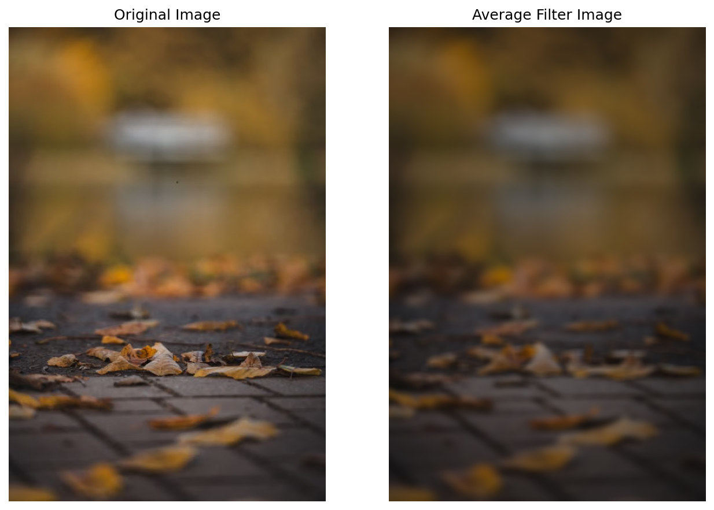
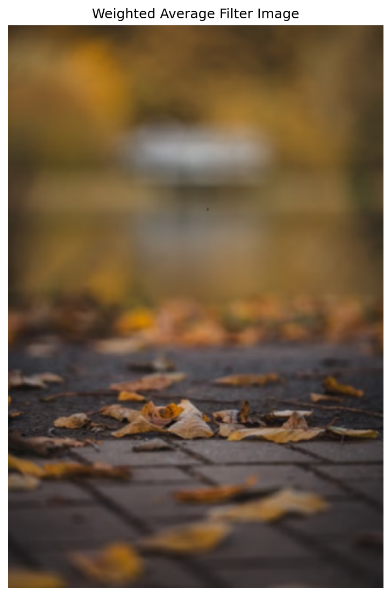
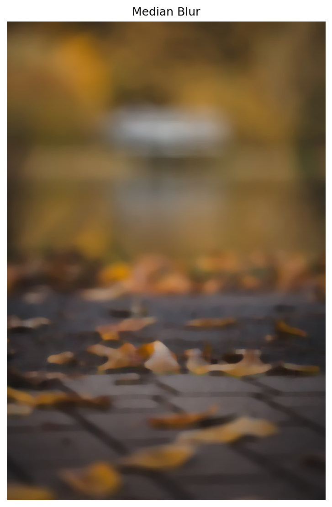
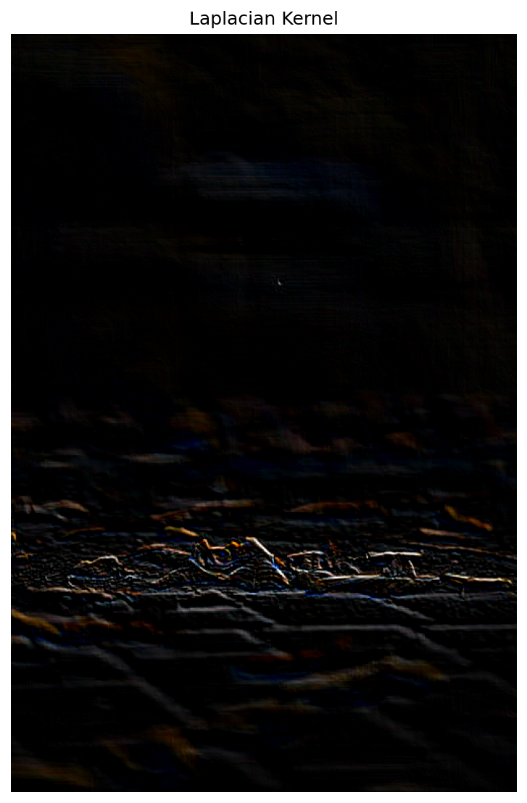
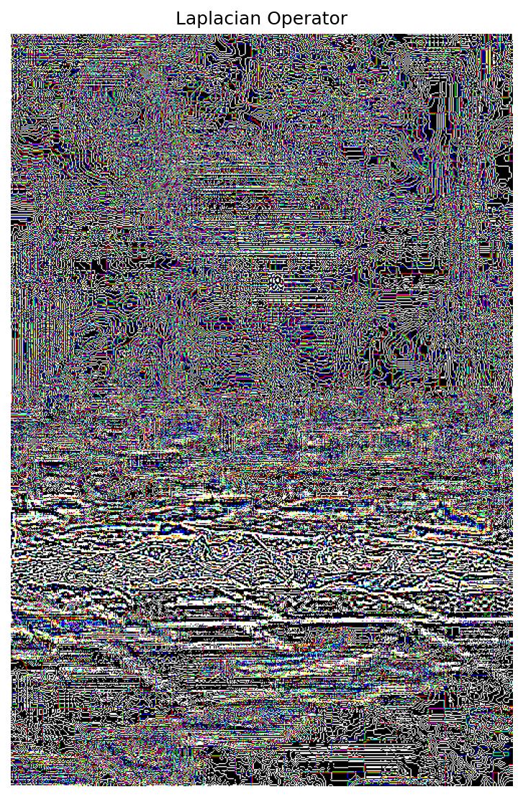

# Image Smoothing and Sharpening Using OpenCV

## Aim

To write a Python program using OpenCV to apply different smoothing filters (Averaging, Weighted Averaging, Gaussian, Median) and sharpening filters (Laplacian Kernel and Laplacian Operator) for image enhancement, and display each result separately along with the original image for comparison.

---

## The program performs the following operations:

- Read and display an input image  
- Apply Averaging filter  
- Apply Weighted Averaging filter  
- Apply Gaussian filter  
- Apply Median filter  
- Apply Laplacian sharpening using kernel  
- Apply Laplacian operator  
- Display all outputs for comparison  

---

## Software Used

- Anaconda – Python 3.7 / Python 3.x  
- Jupyter Notebook / VS Code  
- OpenCV (`cv2`)  
- NumPy  
- Matplotlib  

---

## Algorithm

### Step 1:
Import the required libraries: OpenCV, NumPy, and Matplotlib.

### Step 2:
Read the input image (e.g., `birds.jpeg`).

### Step 3:
Convert the image from BGR to RGB format for display.

### Step 4:
Apply Averaging Filter using `cv2.filter2D()`.

### Step 5:
Apply Weighted Averaging Filter using a custom kernel with `cv2.filter2D()`.

### Step 6:
Apply Gaussian Filter using `cv2.GaussianBlur()`.

### Step 7:
Apply Median Filter using `cv2.medianBlur()`.

### Step 8:
Apply Laplacian Sharpening using Kernel with `cv2.filter2D()`.

### Step 9:
Apply Laplacian Operator using `cv2.Laplacian()`.

### Step 10:
Display all filtered images for comparison.

---

## Developed By

### Name: SUSHMITHA S
### Register No: 212224230282

---

## Program

### Smoothing Filters

#### 1. Averaging filter 
```python
import cv2
import matplotlib.pyplot as plt
import numpy as np

image1 = cv2.imread("birds.jpeg")
image2 = cv2.cvtColor(image1, cv2.COLOR_BGR2RGB)
kernel = np.ones((11, 11), np.float32) / 169
image3 = cv2.filter2D(image2, -1, kernel)

plt.figure(figsize=(9, 9))
plt.subplot(1, 2, 1)
plt.imshow(image2)
plt.title("Original Image")
plt.axis("off")

plt.subplot(1, 2, 2)
plt.imshow(image3)
plt.title("Average Filter Image")
plt.axis("off")
plt.show()
```

#### 2. Weighted averaging
```python
kernel1 = np.array([[1, 2, 1], [2, 4, 2], [1, 2, 1]]) / 16
image3 = cv2.filter2D(image2, -1, kernel1)

plt.imshow(image3)
plt.title("Weighted Average Filter Image")
plt.axis("off")
plt.show()
```

#### 3. Gaussian filter
```python
gaussian_blur = cv2.GaussianBlur(image2, (33, 33), 0, 0)

plt.imshow(gaussian_blur)
plt.title("Gaussian Blur")
plt.axis("off")
plt.show()
```

#### 4. Median filter
```python
median = cv2.medianBlur(image2, 13)

plt.imshow(median)
plt.title("Median Blur")
plt.axis("off")
plt.show()
```

---

### Sharpening Filters

#### 5. Laplacian kernel
```python
kernel2 = np.array([[-1, -1, -1], [2, -2, 1], [2, 1, -1]])
image3 = cv2.filter2D(image2, -1, kernel2)

plt.imshow(image3)
plt.title("Laplacian Kernel")
plt.axis("off")
plt.show()
```

#### 6. Laplacian operator
```python
laplacian = cv2.Laplacian(image2, cv2.CV_64F)

plt.imshow(laplacian)
plt.title("Laplacian Operator")
plt.axis("off")
plt.show()
```

---

## Output

### Smoothing Filters

- **Averaging filter produces blurred image:**  
<br>


- **Weighted averaging provides smoother result with less distortion:**  
<br>


- **Gaussian filter preserves edges better while reducing noise:**  
<br>


- **Median filter removes noise effectively:**  
<br>


---

### Sharpening Filters

- **Laplacian kernel enhances edges and fine details:**  
<br>


- **Laplacian operator detects edges clearly:**  
<br>


---

## Result

Thus, smoothing filters and sharpening filters are successfully implemented using OpenCV.

The smoothing filters reduce noise and improve image quality, while sharpening filters enhance edges and details for better feature extraction.
